

  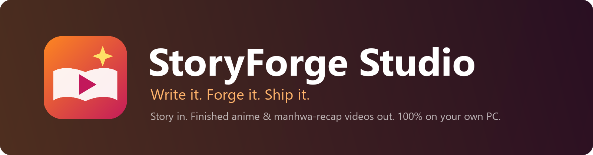

  

  
  
  
  
  
  

  <a href="#overview">Overview</a> ·
  <a href="#storyforge-studio-full-edition">Full edition</a> ·
  <a href="#storyforge-studio-lite">Lite edition</a> ·
  <a href="#compare-the-editions">Compare</a> ·
  <a href="#installation">Installation</a> ·
  <a href="#faq">FAQ</a> ·
  <a href="#support">Support</a>

---

## Overview

**StoryForge Studio** is a desktop application for Windows that turns stories into finished, publish-ready
videos. Everything runs on your own computer: no subscriptions, no usage credits, no cloud uploads, and your
stories and footage never leave your PC.

It comes in two editions. You choose one when you install it, and the installer recommends the right one for
your PC.

<table>
  <tr>
    <th width="50%">StoryForge Studio (Full)</th>
    <th width="50%">StoryForge Studio Lite</th>
  </tr>
  <tr>
    <td>The complete AI studio: AI-written and AI-illustrated films, manhwa recaps, an AI video editor,
        Reddit stories and a full timeline editor.</td>
    <td>Reddit story videos and the timeline editor, on almost any Windows PC. No graphics card required.</td>
  </tr>
  <tr>
    <td><b>Needs:</b> NVIDIA RTX card with 10 GB VRAM, about 75 GB of disk space</td>
    <td><b>Needs:</b> any Windows 10/11 PC, about 3 GB (+2.8 GB gameplay background)</td>
  </tr>
  <tr>
    <td align="center"><a href="#storyforge-studio-full-edition">Read about Full ↓</a></td>
    <td align="center"><a href="#storyforge-studio-lite">Read about Lite ↓</a></td>
  </tr>
</table>

---

## StoryForge Studio (Full edition)

**For creators with a gaming PC** (NVIDIA RTX, 10 GB or more) who want the computer to do the heavy lifting:
write the story, draw every scene, voice it, and cut it together. It includes everything in Lite as well.

  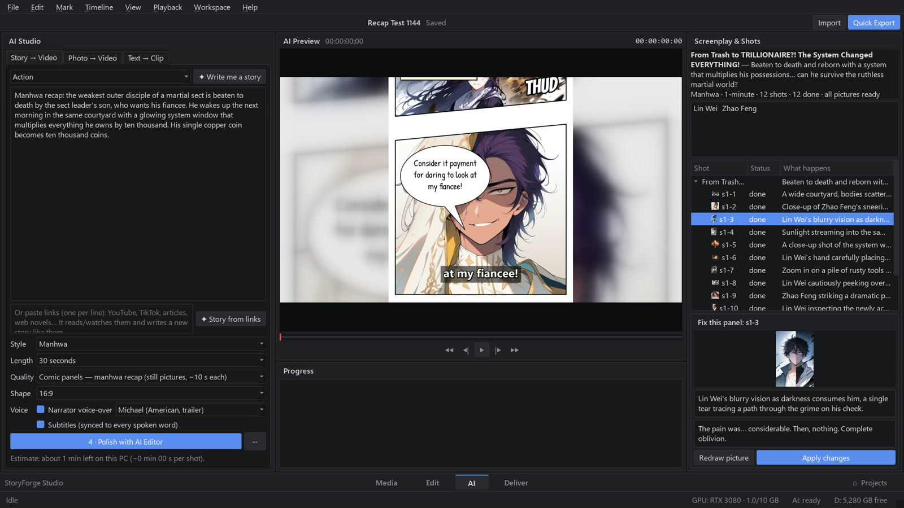
   <b>AI Studio.</b> The story on the left, the generated screenplay and shot list on the right, and any panel can be redrawn or rewritten individually.

### Features

#### Story and writing
- **Story to video.** Paste a story or script and the screenplay follows it faithfully: the same characters,
  events and dialogue.
- **Story generator.** Choose from 20 genres and receive a complete, structured story sized to the length of
  your video.
- **Story from links.** Provide YouTube videos or web articles as reference. StoryForge Studio reads the
  captions (or transcribes the audio at 2× speed) and writes an original story in a similar style.
- **Auto-accept.** Click *Write Screenplay* once and it writes, illustrates, voices and assembles the whole
  film by itself. It pauses only if something needs your attention.

#### Visuals
- **Manhwa recap format.** Full comic pages with slanted panels, speech bubbles, caption boxes and sound
  effects, presented with a scrolling-page camera and smooth transitions.
- **Anime films.** Illustrated keyframes animated into video clips with local video models (Wan 2.2, LTX-Video).
- **Consistent characters.** Each character receives a reference portrait, so the same face appears in every
  panel.
- **Panel-level control.** Redraw a single picture or rewrite a single line without regenerating the film.
- **Photo → Video and Text → Clip.** Animate a photo or generate a single shot from a description.

#### Audio
- **Natural narration.** Expressive text-to-speech voices (25 to choose from) with tight timing and no
  unnatural pauses.
- **Word-synced subtitles.** Captions are aligned to every spoken word.
- **Broadcast-ready loudness.** Exports are normalized to the −14 LUFS streaming standard.

#### Editing
- **AI editor.** Describe an edit in plain language ("make a 45-second Short with captions") and it is
  applied as a single undoable step. It watches and listens to your footage to understand it.
- **Smart tools.** Beat-synced cuts, subject-tracking reframe from 16:9 to 9:16, color matching and
  automatic music ducking.
- **Full timeline editor.** Everything listed under Lite below.

#### Publishing
- **Titles and thumbnails.** Five title options, a description, search tags and a 1280×720 thumbnail drawn in
  your film's style.
- **One-click YouTube upload** with scheduling, **done notifications**, **brand kit** and **problem
  reports**: the same as in Lite.

<table>
  <tr>
    <td width="50%">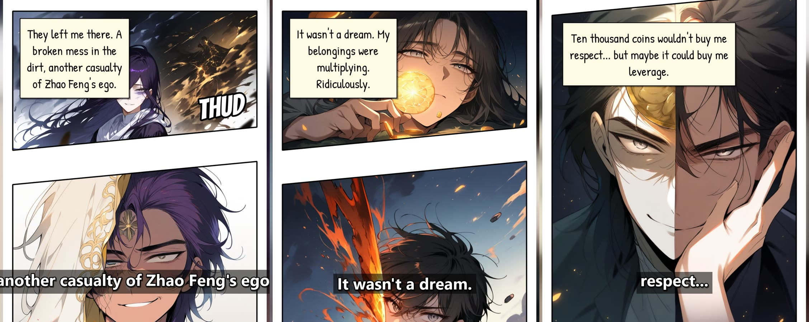</td>
    <td width="50%">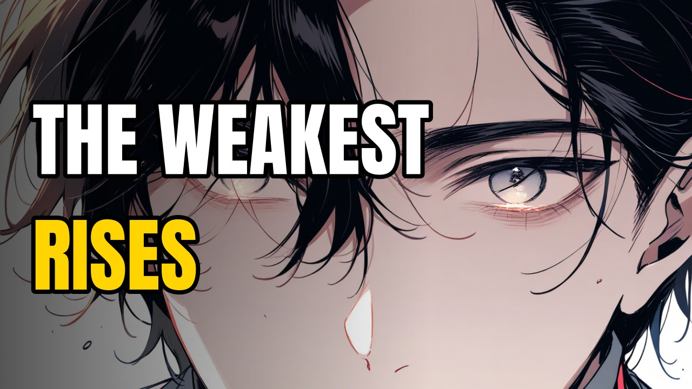</td>
  </tr>
  <tr>
    <td align="center">Generated recap pages with bubbles, SFX and subtitles</td>
    <td align="center">Generated thumbnail</td>
  </tr>
</table>

### How a film is made

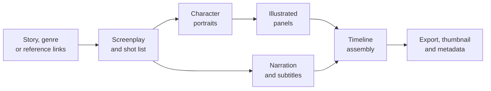

1. **Write.** A local language model plans the screenplay from your story, scene by scene.
2. **Illustrate.** A local image model draws each panel, guided by the character portraits for consistency.
3. **Voice.** Each line is recorded with neural text-to-speech, and its word timings drive the subtitles.
4. **Assemble.** Pages, voice, music and captions are placed on the timeline, where everything stays editable.
5. **Publish.** Export in YouTube or Shorts format with a generated thumbnail, titles and description.

### Full edition requirements

| Component | Minimum | Recommended |
|---|---|---|
| Operating system | Windows 10 64-bit | Windows 11 64-bit |
| Graphics | NVIDIA GeForce RTX, 10 GB VRAM | RTX 3080 / RTX 4070 or higher |
| Memory | 32 GB RAM | 64 GB RAM |
| Storage | 100 GB free | 150 GB free on an SSD |
| Internet | For installation and updates | Broadband |

### What the Full edition installs

| Component | Size | Used for |
|---|---|---|
| Python, FFmpeg and the app | ~2 GB | The editor, rendering and export |
| Ollama + AI writing and editing models (Mistral Small 24B, Gemma 3 12B, Qwen 2.5 7B, Qwen 2.5-VL 7B) | ~33 GB | Screenplays, narration, the AI editor, watching footage |
| AI video engine (ComfyUI + PyTorch CUDA) | ~4 GB | Drawing pictures and making video clips |
| AI image and video models (Animagine XL, Wan 2.2, LTX-Video, IP-Adapter) | ~35 GB | Illustrations, animation, consistent characters |
| Voices (Kokoro, 25 voices) and speech recognition (Whisper) | ~1 GB | Narration, word-synced subtitles, transcription |
| Music, sound effects, fonts and the asset library | ~0.5 GB | Editing |
| Minecraft parkour background | 2.8 GB | Reddit stories (downloaded on first use) |

---

## StoryForge Studio Lite

**For everyone else.** Lite runs on almost any Windows PC, including laptops without a gaming graphics card. It
makes Reddit story videos in minutes and includes the full timeline editor. The voices run on your processor,
so no NVIDIA card is needed.

  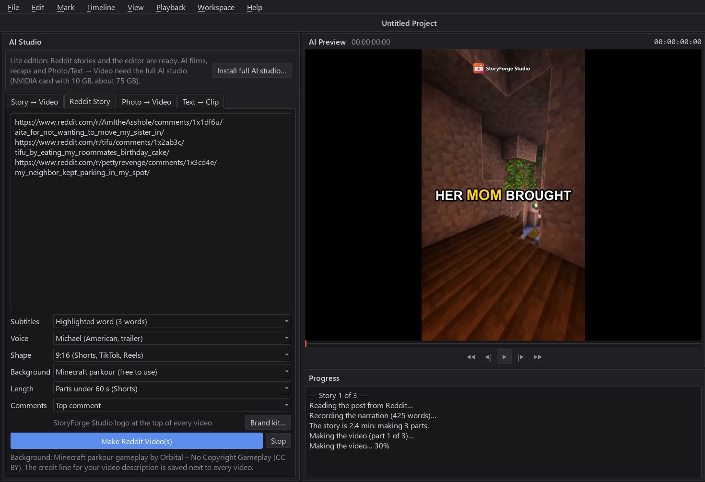
   <b>StoryForge Studio Lite.</b> Three Reddit links pasted as a batch, split into Shorts-length parts with the top comment, while the preview shows the finished video.

### Features

#### Reddit stories
- **Find stories in the app.** Browse the top posts of story subreddits (AITA, TIFU, pettyrevenge, Malicious
  Compliance and more) by day, week, month or year, filter by length, and tick the ones you want. Stories
  you have already made are marked, so you never repeat one.
- **Or paste a post or a link.** Copy a Reddit post from your browser, or paste just its link. Page clutter
  (votes, usernames, "Share", "Reply") is removed automatically.
- **Top comments.** From a link, the post's top one to three comments can be read at the end. This works well
  for AITA verdicts.
- **Your choice of voice.** 25 natural narrator voices, each with a ▶ preview button. Reddit shorthand is read
  properly: "AITA" becomes "Am I the A-hole" and "(24F)" becomes "24 female".
- **Pronunciations.** Teach the narrator tricky names and slang ("Siobhan" → "Shiv awn"); the subtitles still
  show the word as written.
- **Advertiser-friendly language.** Strong swear words and slurs are bleeped (or muted) in the voice and shown
  as `f***` in the subtitles and on the title card, so videos keep full YouTube ads. Mild words like "damn"
  stay.
- **Four subtitle styles,** all timed to each spoken word:
  - **Bold pop:** one big word at a time.
  - **Highlighted word:** three words, the current one in colour.
  - **Karaoke line:** the current word highlighted, upcoming words faded.
  - **Classic captions:** sentences on a dark box.
- **Story card.** The title appears on a clean card while the narrator reads it.
- **Gameplay background.** Free-to-use Minecraft parkour (Creative Commons, credited automatically) starting
  at a different point every time, or your own gameplay video.
- **Parts for Shorts.** Long stories are split into Part 1, Part 2… under 60 seconds (or 3 minutes), at the
  end of a sentence, each ending with "Follow for Part 2".
- **Batch mode.** Paste several links (one per line) or several posts separated by `---`, click once, and get
  every video.
- **9:16 or 16:9.** Vertical for Shorts, TikTok and Reels, or widescreen for YouTube.

  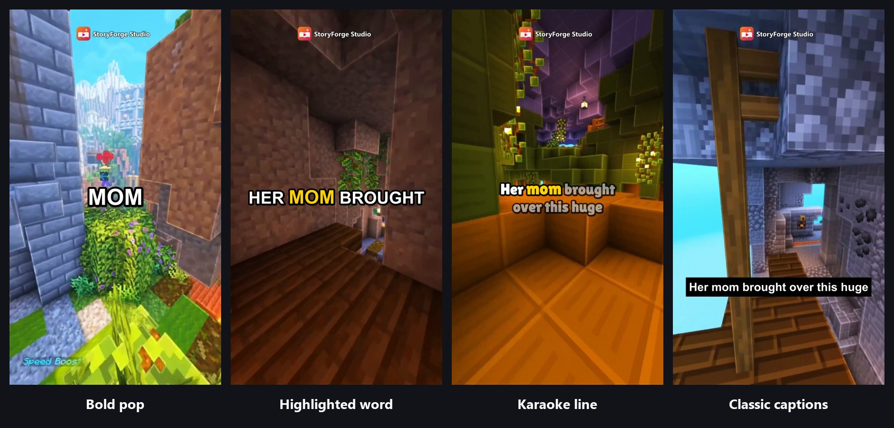
   <b>Four subtitle styles,</b> each timed to the narrator's words.

  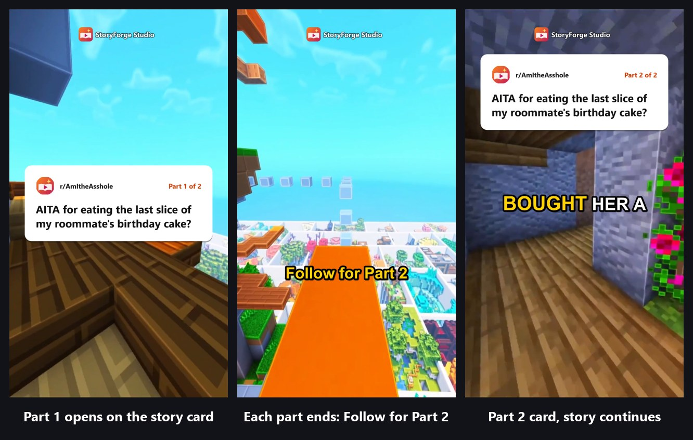
   <b>Parts for Shorts.</b> A long story becomes Part 1 and Part 2, each under 60 seconds.

#### Your brand
- **Brand kit.** Your highlight colour for the subtitles, and your own intro and outro clips on every video.
- **StoryForge Studio logo** at the top of every video and on the story card.

#### Editing
- **Full timeline editor.** Multi-track video and audio, trimming, effects, titles, transitions, speed and
  volume controls, and a Resolve-style page layout.
- **Asset library.** Royalty-free music (Kevin MacLeod), 730 sound effects (Kenney), 106 fonts, and
  backgrounds and overlays made on your PC.
- **Exports** in YouTube 1080p, Shorts 9:16 and square formats, loudness-matched for streaming platforms.

#### Publishing and help
- **One-click YouTube upload.** Title, description (with the required credits), tags, thumbnail and
  visibility, or schedule the video to go public at a set time. It connects with your own Google key, a
  one-time, 10-minute setup that the app walks you through.
- **One part a day.** A story split into parts can be uploaded in one click, scheduled one part per day.
- **Done notifications.** A Windows notification when a render, a batch of Reddit videos or an upload
  finishes.
- **Send Problem Report.** One click saves the logs and PC details (with your Windows user name hidden) as a
  zip, ready to attach to a report.

  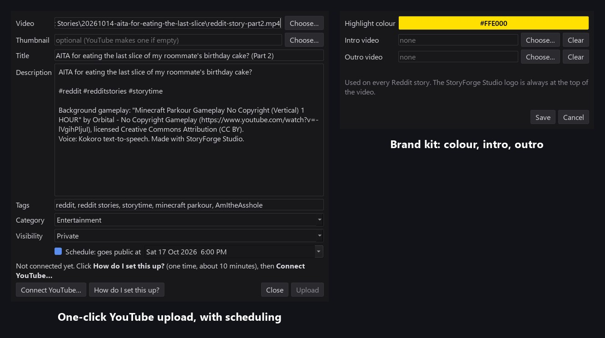
   <b>Publishing.</b> Upload straight to YouTube (or schedule it), with the title, description, credits and tags filled in for you.

### How a Reddit video is made

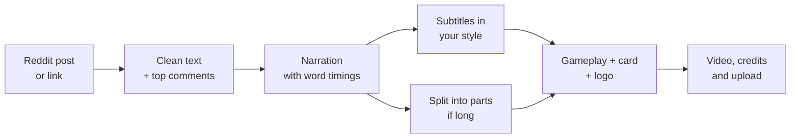

A one-minute story takes well under a minute to make on a typical PC.

  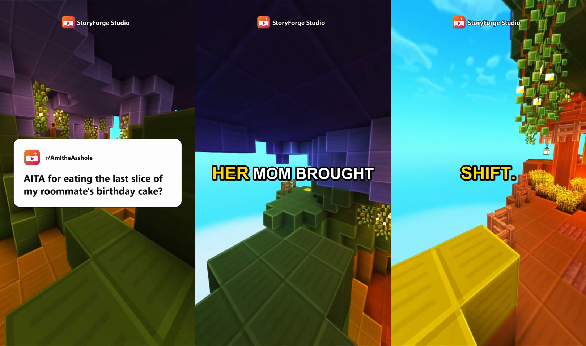
   <b>The finished video:</b> story card, word-highlighted subtitles and Minecraft parkour gameplay (CC BY).

### Lite edition requirements

| Component | Minimum | Recommended |
|---|---|---|
| Operating system | Windows 10 64-bit | Windows 11 64-bit |
| Graphics | Any (no NVIDIA card needed) | Any |
| Memory | 8 GB RAM | 16 GB RAM |
| Storage | 10 GB free | 20 GB free |
| Internet | For installation, updates and Reddit links | Broadband |

### What the Lite edition installs

| Component | Size | Used for |
|---|---|---|
| Python, FFmpeg and the app | ~2 GB | The editor, rendering and export |
| Voice engine (Kokoro on the processor) and 25 voices | ~1.3 GB | Narration with word timings |
| Speech recognition (Whisper) | ~0.5 GB | Captions |
| Music, sound effects, fonts and the asset library | ~0.5 GB | Editing |
| Minecraft parkour background | 2.8 GB | Reddit stories (downloaded on first use) |

### Upgrading from Lite to Full

If you later get a suitable NVIDIA card, choose **Help › Install the Full AI Studio**. StoryForge Studio closes,
downloads the rest (about 75 GB) and opens again. Your projects and settings are kept.

---

## Compare the editions

| | Full | Lite |
|---|:---:|:---:|
| Reddit story videos (story finder, links, comments, parts, batch) | ✓ | ✓ |
| Four word-synced subtitle styles, 25 voices with preview, pronunciations | ✓ | ✓ |
| Swear-word bleeping for advertiser-friendly videos | ✓ | ✓ |
| Brand kit (highlight colour, intro, outro) | ✓ | ✓ |
| Timeline editor, music, sound effects, fonts | ✓ | ✓ |
| One-click YouTube upload with scheduling | ✓ | ✓ |
| Done notifications and problem reports | ✓ | ✓ |
| Story → Video (AI-written and illustrated films) | ✓ | — |
| Manhwa recaps with consistent characters | ✓ | — |
| Photo → Video and Text → Clip | ✓ | — |
| AI editor (edit by describing it) | ✓ | — |
| AI thumbnails and titles | ✓ | — |
| Graphics card | NVIDIA RTX, 10 GB | Any |
| Disk space | ~75 GB | ~3 GB (+2.8 GB background) |

---

## Installation

1. Download **[StoryForgeStudio.exe](https://github.com/kadenvbordeaux-dev/StoryForgeStudio/releases/latest/download/StoryForgeStudio.exe)**.
2. Run it. The installer checks your graphics card, recommends **Full** or **Lite**, and asks which one
   you want.
3. It picks the drive with the most free space, installs everything for that edition and creates a
   **StoryForge Studio** desktop shortcut. Launch it from there and create your first project.

If the installation is interrupted, run the installer again and it resumes where it stopped. The installer is
the same file for both editions.

### Updating

StoryForge Studio checks for new releases at startup. When an update is available, select **Update now** in
the status bar. Projects, settings and downloaded models are preserved, and your edition stays the same.

**Safe updates.** Before updating, StoryForge Studio keeps a copy of the version that works on your PC. If a new
version ever fails to start, it automatically goes back to that copy, tells you, and skips that version until
the next one is released.

**Upgrading from Video Editor AI.** Download the latest
[StoryForgeStudio.exe](https://github.com/kadenvbordeaux-dev/StoryForgeStudio/releases/latest/download/StoryForgeStudio.exe)
and run it. It locates your existing installation on any drive or user folder, updates it in place and
renames the folder to `StoryForgeStudio`. Your projects and AI models are kept, and only new components are
downloaded. If the installation cannot be located automatically, you are asked to select its folder before
anything is downloaded.

## FAQ

<b>Which edition should I choose?</b>

 
If you have an NVIDIA RTX graphics card with 10 GB or more and want AI-made films, recaps or the AI editor,
choose <b>Full</b>. For Reddit story videos and editing on any other PC, choose <b>Lite</b>. The installer
recommends one for your PC, and you can upgrade Lite to Full later.

<b>Windows SmartScreen or my antivirus shows a warning when I run the installer.</b>

 
StoryForge Studio is a new application and its installer is not yet code-signed, so Windows SmartScreen and
some antivirus products scan it before first use. Select <b>More info</b>, then <b>Run anyway</b>. If your
antivirus quarantines the file, restore it and add an exception. The installer downloads components only from
their official distribution sources.

<b>My antivirus removed StoryForgeStudio.exe from the installation folder.</b>

 
StoryForge Studio keeps working: setup detects the removal and points the <b>StoryForge Studio</b> desktop
shortcut at the application directly. You can also start it with <code>launch.bat</code> in the installation
folder. To restore the launcher, open your antivirus quarantine (for Bitdefender:
<i>Protection → Antivirus → Quarantine</i>), restore <code>StoryForgeStudio.exe</code>, and add the
installation folder as an exception. Alternatively, download the latest
<a href="https://github.com/kadenvbordeaux-dev/StoryForgeStudio/releases/latest/download/StoryForgeStudio.exe">StoryForgeStudio.exe</a>
and run it again.

<b>How do I connect YouTube for one-click uploads?</b>

 
Open <b>File › Upload to YouTube</b> and click <b>How do I set this up?</b>. Google requires a free key that the
channel owner creates once in the Google Cloud console (about 10 minutes); the app shows each step. After that,
uploads and scheduling are one click. Each key allows about six uploads a day, which is YouTube's free limit.

<b>Does StoryForge Studio work offline?</b>

 
Yes. An internet connection is needed only for installation, downloads, update checks, Reddit links and
YouTube uploads. Writing, illustration, narration and editing all run on your computer.

<b>Can I monetize videos made with StoryForge Studio?</b>

 
The bundled music is by Kevin MacLeod (CC BY 4.0) and the Minecraft parkour background is by Orbital – No
Copyright Gameplay (CC BY); both require attribution. A credits file is written next to every video and added
to the YouTube description automatically. Sound effects are CC0. Review the licenses of the AI models listed
below for any additional terms. Reddit posts belong to their authors.

<b>Where are my projects stored?</b>

 
In the <code>projects</code> folder inside the installation directory (by default <code>X:\StoryForgeStudio</code>).
Reddit videos are in each project's <code>Reddit Stories</code> folder. Updates never modify your projects.

<b>Is any of my data collected?</b>

 
No. StoryForge Studio has no telemetry or accounts. The only network requests it makes are update checks to
GitHub, downloads during setup, the links you choose to provide, and YouTube uploads you start.

## Third-party components

StoryForge Studio downloads the following components from their official sources during setup. Each remains
under its own license. Lite uses only the components marked with •.

| Component | Purpose | License |
|---|---|---|
| [ComfyUI](https://github.com/comfyanonymous/ComfyUI) | Image and video generation runtime | GPL-3.0 |
| [Animagine XL](https://huggingface.co/cagliostrolab) | Illustration model | CreativeML Open RAIL++-M |
| [IP-Adapter](https://github.com/tencent-ailab/IP-Adapter) | Character consistency | Apache-2.0 |
| [Wan 2.2](https://github.com/Wan-Video/Wan2.2) | Video generation model | Apache-2.0 |
| [LTX-Video](https://github.com/Lightricks/LTX-Video) | Video generation model | See model license |
| [Ollama](https://ollama.com) | Local language-model runtime | MIT |
| Mistral Small, Qwen 2.5, Gemma 3 | Writing and editing models | Apache-2.0 / Gemma Terms of Use |
| • [Kokoro](https://huggingface.co/hexgrad/Kokoro-82M) | Text-to-speech voices | Apache-2.0 |
| • [faster-whisper](https://github.com/SYSTRAN/faster-whisper) | Speech recognition | MIT |
| • [FFmpeg](https://ffmpeg.org) | Media processing | LGPL / GPL |
| • [Kenney](https://kenney.nl) | Sound effects | CC0 |
| • [Kevin MacLeod](https://incompetech.com) | Music | CC BY 4.0 |
| • [Orbital – No Copyright Gameplay](https://www.youtube.com/channel/UCTGjE7hWuBRNqU-OnVSzq3Q) | Minecraft parkour background (Reddit stories) | CC BY |
| • [Google Fonts](https://fonts.google.com) | Typefaces | SIL OFL / Apache-2.0 |

## Support

Found a bug or have a feature request? In the app, choose **Help › Send Problem Report**: it saves the logs and
your PC details (with your Windows user name hidden) as a zip on your desktop and opens a
[new issue](https://github.com/kadenvbordeaux-dev/StoryForgeStudio/issues/new) to attach it to.

---

   
  <b>StoryForge Studio</b> 
  Write it. Forge it. Ship it. 
  © 2026 StoryForge Studio. All rights reserved.

