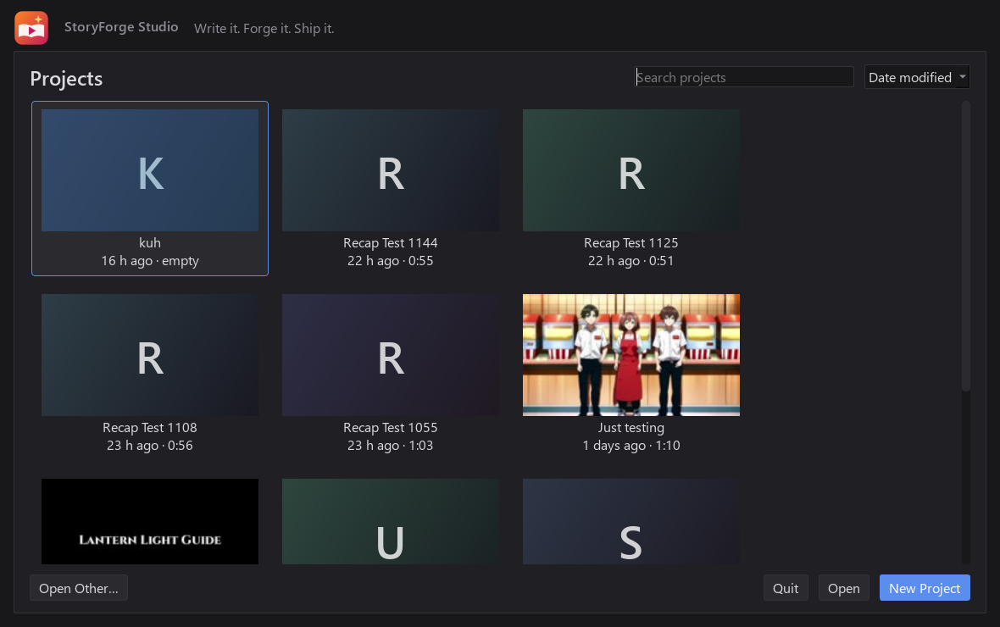

  

  

  
  
  
  

---

**StoryForge Studio** turns a story into a finished video. Paste a story, pick a genre, or drop in a link, and
it writes the narration, draws every panel, voices it, adds subtitles and music, and cuts it on a timeline,
ready to upload. Everything runs **on your own PC**: no subscriptions, no cloud and no per-video credits.

  
   Manhwa recap pages from one story prompt: panels, speech bubbles, SFX, voice and subtitles, all made by the app.

## ✦ What it does

| | |
|---|---|
| 📖 **Story → Video** | Paste a story and it follows it faithfully. Or pick one of 20 genres and get a full story written for you. |
| 🔗 **Story from links** | Paste a YouTube video or web page: it reads the captions (or listens at 2×) and writes a story in that style. |
| 🗯️ **Manhwa recap mode** | Slanted comic panels, speech bubbles, SFX, a rolling-page camera and smooth crossfades: the recap-channel look. |
| 🧑‍🎨 **Consistent characters** | Every character gets a portrait, and their face stays the same in every panel. |
| 🎙️ **Natural narration** | Human-sounding voices with word-synced subtitles and no awkward gaps. |
| 🛠️ **Fix any panel** | Redraw one picture or rewrite its line without touching the rest. |
| 🖼️ **Thumbnail & titles** | 5 click-worthy titles, a description, tags and a bold YouTube thumbnail. |
| ⬆️ **Upload to YouTube** | Exports the video and gets everything ready to paste into YouTube Studio. |
| 🎬 **A real editor** | A full timeline editor (cuts, effects, text, music, beat sync, smart reframe, loudness) plus an AI editor you can just ask. |

  
  

## ⬇ Install

1. **[Download StoryForgeStudio.exe](https://github.com/kadenvbordeaux-dev/storyforge-studio/releases/latest/download/StoryForgeStudio.exe)**.
2. Double-click it. It installs everything it needs (Python, FFmpeg, the AI models and the voices) onto your
   drive with the most free space, and adds a **StoryForge Studio** shortcut to your desktop.
3. That's it. The app **updates itself**: when a new version is out, click **Update now** in the status bar.

The first install downloads the AI models (about 75 GB), so leave it running. Your projects are never touched
by updates.

## 💻 Requirements

| | Minimum | Recommended |
|---|---|---|
| OS | Windows 10 (64-bit) | Windows 11 |
| GPU | NVIDIA RTX, 10 GB VRAM | RTX 3080 / 4070 or better |
| RAM | 32 GB | 64 GB |
| Disk | 100 GB free | an SSD with 150 GB free |

## ❓ FAQ

<b>Windows says "Windows protected your PC" or my antivirus scans it</b>

StoryForge Studio is new and isn't code-signed yet, so Windows SmartScreen and some antivirus programs
(e.g. Bitdefender) check it before the first run. Click **More info → Run anyway**. If your antivirus holds
it, choose **Restore / Allow**. The app only downloads from the official sites of the tools and
models it uses (Python, FFmpeg, Ollama, Hugging Face, GitHub). This warning goes away as more people use it, and for good once the app is signed.

<b>Does it need the internet?</b>

Only to install, to download models, and to check for updates. Writing, drawing, voicing and editing all
run offline on your GPU.

<b>Can I use the videos on YouTube?</b>

Yes. The music is Kevin MacLeod (CC BY), and a credits file is written next to every export (it's also added
to the YouTube description for you). Sound effects are CC0. The small StoryForge Studio watermark can be
turned off in Render Settings.

<b>Where are my projects?</b>

In the `projects` folder of the install (shown in the Project Manager). Updates never touch them.

---

   
  <b>StoryForge Studio</b>: <i>Write it. Forge it. Ship it.</i>

