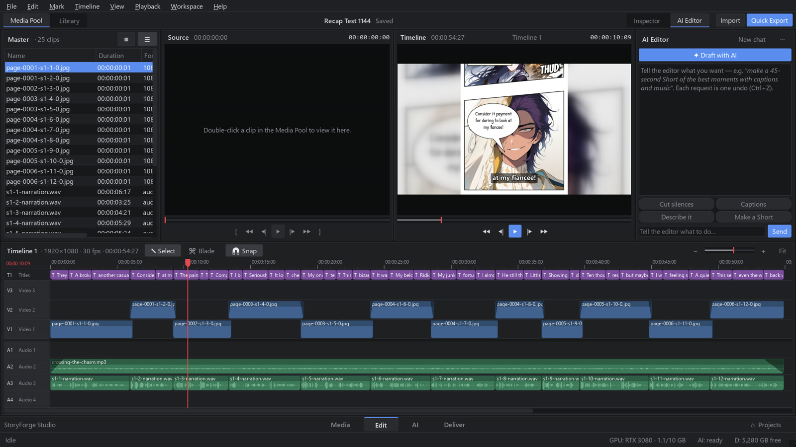
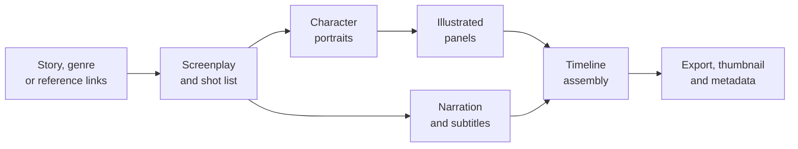

  

  

  
  
  
  
  

  <a href="#overview">Overview</a> ·
  <a href="#features">Features</a> ·
  <a href="#how-it-works">How it works</a> ·
  <a href="#installation">Installation</a> ·
  <a href="#system-requirements">Requirements</a> ·
  <a href="#faq">FAQ</a> ·
  <a href="#support">Support</a>

---

## Overview

**StoryForge Studio** is a desktop application for Windows that turns a written story into a finished,
publish-ready video. It writes the narration, illustrates every scene in a consistent style, records the
voice-over, adds word-synced subtitles and licensed music, and assembles the result on a professional
timeline editor.

All generation runs locally on your NVIDIA GPU. There are no subscriptions, usage credits or cloud uploads,
and your stories and footage never leave your computer.

  
   <b>AI Studio.</b> The story on the left, the generated screenplay and shot list on the right, and any panel can be redrawn or rewritten individually.

## Features

### Story and writing
- **Story to video.** Paste a story or script and the screenplay follows it faithfully: the same characters,
  events and dialogue.
- **Story generator.** Choose from 20 genres and receive a complete, structured story sized to the length of
  your video.
- **Story from links.** Provide YouTube videos or web articles as reference. StoryForge Studio reads the
  captions (or transcribes the audio at 2× speed) and writes an original story in a similar style.

### Visuals
- **Manhwa recap format.** Full comic pages with slanted panels, speech bubbles, caption boxes and sound
  effects, presented with a scrolling-page camera and smooth transitions.
- **Consistent characters.** Each character receives a reference portrait, so the same face appears in every
  panel.
- **Panel-level control.** Redraw a single picture or rewrite a single line without regenerating the film.

### Audio
- **Natural narration.** Expressive text-to-speech voices with tight timing and no unnatural pauses.
- **Word-synced subtitles.** Captions are aligned to every spoken word.
- **Broadcast-ready loudness.** Exports are normalized to the −14 LUFS streaming standard.

### Editing
- **Full timeline editor.** Multi-track video and audio, trimming, effects, titles, transitions, speed and
  volume controls, and a Resolve-style page layout.
- **AI editor.** Describe an edit in plain language ("make a 45-second Short with captions") and it is
  applied as a single undoable step.
- **Smart tools.** Beat-synced cuts, subject-tracking reframe from 16:9 to 9:16, color matching and automatic
  music ducking.

### Publishing
- **Titles and thumbnails.** Five title options, a description, search tags and a 1280×720 thumbnail.
- **YouTube-ready export.** The video, thumbnail and copy-ready metadata (including music credits) are
  prepared in one folder, and YouTube Studio opens for upload.
- **Branding.** An optional StoryForge Studio watermark can be turned off in Render Settings.

  
   <b>Edit page.</b> The assembled film on a multi-track timeline, with the AI Editor on the right.

<table>
  <tr>
    <td width="50%"></td>
    <td width="50%"></td>
  </tr>
  <tr>
    <td align="center">Generated recap pages with bubbles, SFX and subtitles</td>
    <td align="center">Generated thumbnail</td>
  </tr>
</table>

## How it works

1. **Write.** A local language model plans the screenplay from your story, scene by scene.
2. **Illustrate.** A local image model draws each panel, guided by the character portraits for consistency.
3. **Voice.** Each line is recorded with neural text-to-speech, and its word timings drive the subtitles.
4. **Assemble.** Pages, voice, music and captions are placed on the timeline, where everything stays editable.
5. **Publish.** Export in YouTube or Shorts format with a generated thumbnail, titles and description.

## Installation

1. Download **[StoryForgeStudio.exe](https://github.com/kadenvbordeaux-dev/StoryForgeStudio/releases/latest/download/StoryForgeStudio.exe)**.
2. Run it. The installer selects the drive with the most free space, installs the required components
   (Python, FFmpeg, the AI runtime, models and voices) and creates a **StoryForge Studio** desktop shortcut.
3. Launch StoryForge Studio from the shortcut and create your first project.

The first installation downloads roughly 75 GB of AI models and can take an hour or more, depending on your
connection. If it is interrupted, run the installer again and it resumes where it stopped.

### Updating

StoryForge Studio checks for new releases at startup. When an update is available, select **Update now** in
the status bar. Projects, settings and downloaded models are preserved.

**Upgrading from Video Editor AI.** Download the latest
[StoryForgeStudio.exe](https://github.com/kadenvbordeaux-dev/StoryForgeStudio/releases/latest/download/StoryForgeStudio.exe)
and run it. It locates your existing installation on any drive or user folder, updates it in place and
renames the folder to `StoryForgeStudio`. Your projects and AI models are kept, and only new components are
downloaded. If the installation cannot be located automatically, you are asked to select its folder before
anything is downloaded.

## System requirements

| Component | Minimum | Recommended |
|---|---|---|
| Operating system | Windows 10 64-bit | Windows 11 64-bit |
| Graphics | NVIDIA GeForce RTX, 10 GB VRAM | RTX 3080 / RTX 4070 or higher |
| Memory | 32 GB RAM | 64 GB RAM |
| Storage | 100 GB free | 150 GB free on an SSD |
| Internet | Required for installation and updates | Broadband |

## FAQ

<b>Windows SmartScreen or my antivirus shows a warning when I run the installer.</b>

 
StoryForge Studio is a new application and its installer is not yet code-signed, so Windows SmartScreen and
some antivirus products scan it before first use. Select <b>More info</b>, then <b>Run anyway</b>. If your
antivirus quarantines the file, restore it and add an exception. The installer downloads components only from
their official distribution sources.

<b>My antivirus removed StoryForgeStudio.exe from the installation folder.</b>

 
StoryForge Studio keeps working: setup detects the removal and points the <b>StoryForge Studio</b> desktop
shortcut at the application directly. To restore the launcher, open your antivirus quarantine (for Bitdefender:
<i>Protection → Antivirus → Quarantine</i>), restore <code>StoryForgeStudio.exe</code>, and add the installation
folder as an exception. Alternatively, download the latest
<a href="https://github.com/kadenvbordeaux-dev/StoryForgeStudio/releases/latest/download/StoryForgeStudio.exe">StoryForgeStudio.exe</a>
and run it again.

<b>Does StoryForge Studio work offline?</b>

 
Yes. An internet connection is needed only for installation, model downloads, update checks and the optional
"Story from links" feature. Writing, illustration, narration and editing all run on your computer.

<b>Can I monetize videos made with StoryForge Studio?</b>

 
The bundled music is by Kevin MacLeod (CC BY 4.0) and requires attribution. A credits file is written next
to every export and added to the generated YouTube description automatically. Sound effects are CC0. Review
the licenses of the AI models listed below for any additional terms.

<b>Where are my projects stored?</b>

 
In the <code>projects</code> folder inside the installation directory (by default <code>X:\StoryForgeStudio</code>).
Updates never modify your projects.

<b>Is any of my data collected?</b>

 
No. StoryForge Studio has no telemetry or accounts. The only network requests it makes are update checks to
GitHub, model downloads during setup, and the links you choose to provide.

## Third-party components

StoryForge Studio downloads the following components from their official sources during setup. Each remains
under its own license.

| Component | Purpose | License |
|---|---|---|
| [ComfyUI](https://github.com/comfyanonymous/ComfyUI) | Image and video generation runtime | GPL-3.0 |
| [Animagine XL](https://huggingface.co/cagliostrolab) | Illustration model | CreativeML Open RAIL++-M |
| [IP-Adapter](https://github.com/tencent-ailab/IP-Adapter) | Character consistency | Apache-2.0 |
| [Wan 2.2](https://github.com/Wan-Video/Wan2.2) | Video generation model | Apache-2.0 |
| [LTX-Video](https://github.com/Lightricks/LTX-Video) | Video generation model | See model license |
| [Ollama](https://ollama.com) | Local language-model runtime | MIT |
| Mistral Small, Qwen 2.5, Gemma 3 | Writing and editing models | Apache-2.0 / Gemma Terms of Use |
| [Kokoro](https://huggingface.co/hexgrad/Kokoro-82M) | Text-to-speech voices | Apache-2.0 |
| [faster-whisper](https://github.com/SYSTRAN/faster-whisper) | Speech recognition | MIT |
| [FFmpeg](https://ffmpeg.org) | Media processing | LGPL / GPL |
| [Kenney](https://kenney.nl) | Sound effects | CC0 |
| [Kevin MacLeod](https://incompetech.com) | Music | CC BY 4.0 |
| [Google Fonts](https://fonts.google.com) | Typefaces | SIL OFL / Apache-2.0 |

## Support

Found a bug or have a feature request? [Open an issue](https://github.com/kadenvbordeaux-dev/StoryForgeStudio/issues/new).
Please include your Windows version, GPU model and, if possible, the log file at `app\logs\app.log`.

---

   
  <b>StoryForge Studio</b> 
  Write it. Forge it. Ship it. 
  © 2026 StoryForge Studio. All rights reserved.

